  

 

[GitHub](https://github.com/Dhyanesh006) · [LinkedIn](https://www.linkedin.com/in/dhyanesh-v-741738274) · [X](https://x.com/dhyanesh006) · [Portfolio](https://portfolio-dhyanesh.vercel.app/) · [Email](mailto:dhyanesh.vishnu@gmail.com) · [Proton](mailto:dhyanesh.v@protonmail.com)

  Projects: <a href="https://github.com/Dhyanesh006/Dhyanesh006">profile repo</a> · <a href="https://github.com/Dhyanesh006/portfolio">portfolio</a> · <a href="https://github.com/Dhyanesh006/rentalhub">RentalHub</a> · <a href="https://github.com/Dhyanesh006/pc-store">PC Store</a>

 

  
    One hand-written SVG — every section is original SVG + SMIL, no JavaScript and no external card services. 
    Stats, activity and the daily quote refresh automatically every day via GitHub Actions.
      
    <a href="https://github.com/Dhyanesh006/Dhyanesh006/tree/main/.github/scripts">showcase source</a> · <a href="https://github.com/Dhyanesh006/Dhyanesh006">view source</a>
  

